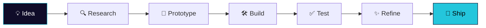

<!-- ═══════════ HEADER (3D wave banner) ═══════════ -->
<div align="center">


<a href="https://github.com/AmmarDevx">
  
</a>

<br/>


</div>

<br/>

<!-- ═══════════ ABOUT ═══════════ -->
## 🧑‍💻 About Me

```js
const ammar = {
  role:      "Creative Developer",
 
  focus:     ["Three.js", "WebGL", "Interactive 3D", "AI-powered web apps"],
  exploring: ["Computer Vision", "Gesture-based interfaces", "Real-time browser AI"],
  motto:     "Build. Break. Learn. Ship. 🚀",
  funFact:   "I'd rather build the tool than search for one."
};
```

> I make websites that don't just work — they **feel alive**. Code + design + a bit of chaos.

<br/>

<!-- ═══════════ TECH STACK ═══════════ -->
## 🛠️ Tech Stack

<div align="center">


<br/><br/>


</div>

<br/>

<!-- ═══════════ 3D CONTRIBUTION GRAPH ═══════════ -->
## 🧊 My 3D Contribution Graph

<div align="center">

<!-- Generated automatically by the GitHub Action in .github/workflows/profile-3d.yml -->


</div>

<br/>

<!-- ═══════════ STATS ═══════════ -->
## 📊 GitHub Stats

<div align="center">


<br/>


<br/><br/>


</div>

<br/>

<!-- ═══════════ ACTIVITY GRAPH ═══════════ -->
## 📈 Activity Graph

<div align="center">

</div>

<br/>

<!-- ═══════════ SNAKE ═══════════ -->
## 🐍 Contribution Snake

<div align="center">
<picture>
  <source media="(prefers-color-scheme: dark)"  srcset="https://raw.githubusercontent.com/AmmarDevx/AmmarDevx/output/github-snake-dark.svg" />
  <source media="(prefers-color-scheme: light)" srcset="https://raw.githubusercontent.com/AmmarDevx/AmmarDevx/output/github-snake.svg" />
  
</picture>
</div>

<br/>

<!-- ═══════════ CURRENTLY ═══════════ -->
## 🔭 Currently

| 🔨 Building | 📚 Learning | 🌱 Exploring |
|:--|:--|:--|
| Interactive 3D web experiences | Advanced Three.js & shaders | Hand-tracking & gesture UI |
| Developer tools | Performance optimization | AI in the browser |
| Creative coding experiments | Modern frontend architecture | Generative visuals |

<br/>

<!-- ═══════════ HOW I BUILD ═══════════ -->
## ⚙️ How I Build



<br/>

<!-- ═══════════ PINNED ═══════════ -->
## 📌 Featured Projects

<div align="center">

<!-- Replace "YOUR-REPO-NAME" with your real repo names -->
<a href="https://github.com/AmmarDevx/YOUR-REPO-NAME">
  
</a>
<a href="https://github.com/AmmarDevx/YOUR-REPO-NAME-2">
  
</a>

</div>

<br/>

<!-- ═══════════ CONNECT ═══════════ -->
## 🤝 Let's Connect

<div align="center">

[](https://github.com/AmmarDevx)
<!-- Add your own links below, then delete this line -->
<!-- [](https://linkedin.com/in/YOUR-ID) -->
<!-- [](mailto:YOUR@EMAIL.com) -->
<!-- [](https://YOUR-SITE.com) -->

<br/>

*"Good code solves problems. Great products also feel good to use."*


</div>
